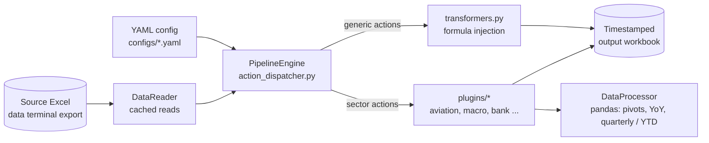

# Industry DB Updater

**English** | [简体中文](README.zh-CN.md)

A configuration-driven Python pipeline that automatically refreshes industry research databases stored as Excel workbooks: it pulls raw indicator data, writes it into report templates, injects native Excel formulas, and keeps charts intact.

Built during a data engineering internship at a securities research institute, where analysts maintain sector databases of **1,000+ worksheets** by hand on a regular basis.

---

## The Problem

Each sector database (aviation, banking, macro, etc.) is a large Excel workbook that analysts update by copying new data from a data terminal export into dozens of formatted sheets, then extending year-over-year formulas, quarterly summaries and chart ranges.

The previous automation scripts were hard-coded per sheet and copy-pasted between sectors, which caused:

- **High maintenance cost**: adding one indicator meant editing Python code
- **Duplicated logic**: the same YoY / date-handling code was rewritten in every script
- **Slow runs**: the same large source file was re-read for every sheet

## The Solution

The pipeline separates **what to do** (YAML configuration) from **how to do it** (reusable engine + sector plug-ins):

- **Config-driven**: each sector database is described by one YAML file. Adding a sheet or indicator only requires editing YAML, with no Python changes.
- **Plug-in architecture**: sector-specific logic lives in isolated plug-in classes, and the engine dispatches to it by action name through a central registry.
- **Read once, write once**: a cached `DataReader` loads each source sheet into memory once, and the target workbook is opened and saved exactly once per run.
- **Native Excel output**: growth rates and summaries are written as real Excel formulas (e.g. `=B16/B4-1`), not hard-coded values, so analysts can still audit and edit the workbook.
- **Safe by default**: every run writes to a timestamped copy of the template and never overwrites the original.

## Architecture



| Layer | Location | Responsibility |
|---|---|---|
| Configuration | `configs/` | One YAML file per sector database: source/target files, sheets, indicator-to-column mapping, ordered actions and post-processing steps |
| Engine | `core_engine/action_dispatcher.py` | Parses YAML, pre-loads data, creates the output copy, routes each action to its handler through the action registry, saves once |
| Data access | `core_engine/data_reader.py` | Validates the source file, caches whole sheets and parsed indicators by `(sheet, indicator_code)`, cleans invalid date rows |
| Data processing | `core_engine/data_processor.py` | pandas utilities: date filtering, month × year pivots, YoY change, quarterly and YTD statistics, indicator merging |
| Excel transforms | `core_engine/transformers.py` | Cross-sector Excel actions such as injecting YoY / MoM formulas into column ranges |
| Sector plug-ins | `plugins/` | Logic unique to one sector (e.g. aviation "vs. 2019" recovery formulas, Spring Festival-aligned pivots for macro data) |
| Runners | `run_pipeline.py`, `run_*.py` | Command-line entry points (single config or batch) |

## How a Run Works

Using the aviation database as an example:

1. **Load config**: the engine reads `configs/db_aviation.yaml`.
2. **Pre-load data**: `DataReader` loads the required source sheets into an in-memory cache.
3. **Open target once**: a timestamped copy of the target template is created and opened.
4. **Dispatch actions**: for each sheet, configured `actions` run in order, followed by `post_processes`:
   - generic formulas → `transformers.apply_formula`
   - aviation-specific steps (e.g. `aviation_write_airline_sheet`) → `AviationPlugin`
5. **Save once**: the workbook is saved to the output directory after all sheets are processed.

## Configuration Example

```yaml
industry: "Transport - Aviation"
source_file: "data/aviation/source.xlsx"
target_file: "data/aviation/target_template.xlsx"
output_dir: "output_files"

defaults:
  start_date: "2014-01-01"
  date_format: "yyyy-mm"
  start_row: 4

sheets:
  - sheet_name: "Air China"
    source_sheet: "Air China"
    indicators:                 # indicator code -> target column
      "AA000058863400": "B"
      "AA000058863500": "E"
    actions:
      - type: "aviation_write_airline_sheet"
      - type: "aviation_apply_yoy_formulas"
        target_cols: ["C", "F"]
        start_row: 16
    post_processes:
      - action: "aviation_clear_early_years_data"
        params:
          yoy_cols: ["C", "F"]
```

## Quick Start

**Requirements:** Python 3.9+

```bash
pip install pandas numpy openpyxl pyyaml zhdate
```

1. Set `source_file`, `target_file` and `output_dir` in the YAML file under `configs/`.
2. Run one database:

   ```bash
   python run_pipeline.py -c configs/db_aviation.yaml
   ```

3. Or run every config in `configs/`:

   ```bash
   python run_pipeline.py --all
   ```

## Extending the Pipeline

**Add a sheet or indicator (no code change).** Copy an existing sheet block in the sector's YAML file, then change `sheet_name`, `source_sheet` and the `indicators` mapping.

**Add new processing logic.**

1. Add a static method `my_action(context, params)` to a plug-in class in `plugins/`. `context` provides `wb`, `ws`, `data_reader`, `sheet_config` and `defaults`.
2. Register it in `actions_registry` in `core_engine/action_dispatcher.py`.
3. Call it from YAML with `type: "my_action"`.

## Coverage

| Sector database | Config | Sheets | Example logic |
|---|---|---|---|
| Transport – Aviation | `db_aviation.yaml` | 9 | 7 airlines; YoY and vs. 2019 growth/difference; quarterly, YTD and full-year blocks; cross-sheet monthly/quarterly summaries via `INDIRECT` |
| Macro (mid-level activity tracking) | `db_macro.yaml` | 30 | ~60 indicators; month-day × year pivots with leap-day handling; Spring Festival week tags and Lunar New Year's Eve-relative pivots (lunar calendar via `zhdate`); ISO-week pivots |
| Banking – key regulatory indicators | `db_bank_commercial.yaml` | 10 | Formula templates with placeholders (`{source_column}`, `{row-N}`, `{tname}`) for basis-point and YoY differences |
| Healthcare | `db_medical.yaml` | 1 | Vertical-to-horizontal reshaping, quarterly headers, MoM/YoY formulas, quarter merging |
| Utilities – Environment | `db_public_env.yaml` | 4 | Descending date layout, per-sheet unit conversion, dynamic report titles |
| Electronics – Memory prices | `db_electronics.yaml` | 3 | Multi-section sheets; chart ranges rolled to the latest two years |
| Consumer – Baijiu | `db_baijiu2.yaml` | 5 | Product matching and chart XML updates |

**Total: 7 sector databases and 60+ worksheets.** The framework is designed to scale to the full 1,000+ sheet database.

## Engineering Notes

- **openpyxl chart bug fix.** openpyxl silently drops charts that reference external data, because `ExternalData.id` does not handle the namespaced `r:id` attribute. The engine monkey-patches the descriptor (`allow_none=True` plus the `REL_NS` namespace mapping) so these charts survive a load–save round trip. See the top of `core_engine/action_dispatcher.py`.
- **Dirty-data tolerance.** Non-date rows in source exports (footers, notes) are coerced and filtered before writing.
- **Calendar-aware analytics.** Macro pivots align years by Spring Festival week or by days relative to Lunar New Year's Eve, so seasonal patterns can be compared across years.

## Documentation

See [`配套文档.md`](配套文档.md) (Chinese) for a function-level reference: inputs and outputs of every engine module and plug-in action, plus a per-sheet checklist for each sector.

## Tech Stack

Python · pandas · NumPy · openpyxl · PyYAML · zhdate
