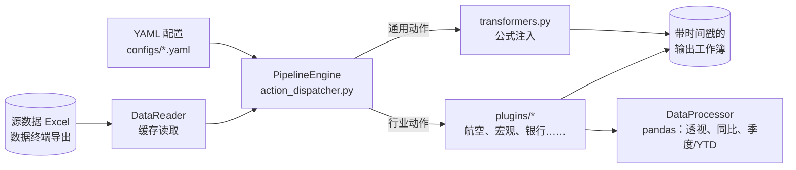

# Industry DB Updater · 行业数据库自动更新

[English](README.md) | **简体中文**

一个配置驱动的 Python 数据管道，用于自动更新以 Excel 形式维护的行业研究数据库：读取原始指标数据，写入报表模板，注入原生 Excel 公式，并保留原有图表。

项目来自券商研究所的数据工程实习。研究员需要定期手动维护 **1,000+ 个 Sheet** 的行业数据库，本项目用于把这项工作自动化。

---

## 背景与痛点

每个行业数据库（航空、银行、宏观等）都是一个大型 Excel 工作簿。研究员要把数据终端导出的新数据复制到几十个带格式的 Sheet 中，再手动延伸同比公式、季度汇总和图表范围。

原有自动化脚本按 Sheet 硬编码，并在各行业之间复制粘贴，带来三个问题：

- **维护成本高**：新增一个指标就要改 Python 代码
- **逻辑重复**：同比计算、日期处理等代码在每个脚本里重写一遍
- **运行慢**：同一个大型源文件被每个 Sheet 重复读取

## 解决方案

采用 **配置驱动（Data-Driven Configuration）+ 流水线（Pipeline）** 设计，把"做什么"（YAML 配置）和"怎么做"（通用引擎 + 行业插件）彻底分离：

- **配置驱动**：每个行业数据库对应一个 YAML 文件。新增 Sheet 或指标只需改 YAML，不用改 Python 代码。
- **插件化架构**：行业特有逻辑封装在独立的插件类中，引擎通过统一的动作注册表按名称分发调用。
- **一次读取、一次写入**：带缓存的 `DataReader` 让每个源 Sheet 只读一次；目标工作簿每次运行只打开、保存一次。
- **输出原生 Excel 公式**：同比、汇总等写入的是真实公式（如 `=B16/B4-1`），不是写死的数值，研究员可以继续核对和修改。
- **默认安全**：每次运行都在模板的带时间戳副本上操作，不会覆盖原文件。

## 架构



| 层级 | 位置 | 职责 |
|---|---|---|
| 配置层 | `configs/` | 每个行业库一个 YAML：源/目标文件、Sheet 列表、指标→列映射、按顺序执行的动作与后处理 |
| 引擎层 | `core_engine/action_dispatcher.py` | 解析 YAML、预加载数据、创建输出副本、通过动作注册表路由到对应处理函数、统一保存 |
| 数据读取 | `core_engine/data_reader.py` | 校验源文件；按 `(sheet, 指标代码)` 缓存整表和解析后的指标；过滤无效日期行 |
| 数据处理 | `core_engine/data_processor.py` | 基于 pandas：日期筛选、月×年透视、同比计算、季度与 YTD 统计、多指标合并 |
| Excel 处理 | `core_engine/transformers.py` | 跨行业通用的 Excel 动作，如向指定列批量注入同比/环比公式 |
| 行业插件 | `plugins/` | 单个行业独有的逻辑（如航空的"相对 2019 年"恢复度公式、宏观的春节对齐透视表） |
| 调度层 | `run_pipeline.py`、`run_*.py` | 命令行入口（单个配置或批量执行） |

## 运行流程

以航空月报为例：

1. **读取配置**：引擎读取 `configs/db_aviation.yaml`。
2. **预加载数据**：`DataReader` 把需要的源 Sheet 加载进内存缓存。
3. **打开目标文件**：创建目标模板的带时间戳副本，只打开一次。
4. **分发执行**：对每个 Sheet 依次执行 `actions`，再执行 `post_processes`：
   - 通用公式 → `transformers.apply_formula`
   - 航空特有逻辑（如 `aviation_write_airline_sheet`）→ `AviationPlugin`
5. **统一保存**：所有 Sheet 处理完成后，一次性保存到输出目录。

## 配置示例

```yaml
industry: "交运-航空"
source_file: "data/aviation/source.xlsx"
target_file: "data/aviation/target_template.xlsx"
output_dir: "output_files"

defaults:
  start_date: "2014-01-01"
  date_format: "yyyy-mm"
  start_row: 4

sheets:
  - sheet_name: "中国国航"
    source_sheet: "中国国航"
    indicators:                 # 指标代码 -> 目标列
      "AA000058863400": "B"
      "AA000058863500": "E"
    actions:
      - type: "aviation_write_airline_sheet"
      - type: "aviation_apply_yoy_formulas"
        target_cols: ["C", "F"]
        start_row: 16
    post_processes:
      - action: "aviation_clear_early_years_data"
        params:
          yoy_cols: ["C", "F"]
```

## 快速开始

**环境要求：** Python 3.9+

```bash
pip install pandas numpy openpyxl pyyaml zhdate
```

1. 在 `configs/` 下对应的 YAML 中设置 `source_file`、`target_file`、`output_dir`。
2. 执行单个数据库：

   ```bash
   python run_pipeline.py -c configs/db_aviation.yaml
   ```

3. 或批量执行 `configs/` 下的全部配置：

   ```bash
   python run_pipeline.py --all
   ```

## 如何扩展

**新增 Sheet 或指标（无需改代码）**：在对应行业的 YAML 中复制一个 Sheet 配置块，修改 `sheet_name`、`source_sheet` 和 `indicators` 映射即可。

**新增处理逻辑**：

1. 在 `plugins/` 的插件类中新增静态方法 `my_action(context, params)`。`context` 中包含 `wb`、`ws`、`data_reader`、`sheet_config`、`defaults`。
2. 在 `core_engine/action_dispatcher.py` 的 `actions_registry` 中注册。
3. 在 YAML 中通过 `type: "my_action"` 调用。

## 已覆盖范围

| 行业数据库 | 配置文件 | Sheet 数 | 代表性逻辑 |
|---|---|---|---|
| 交运-航空 | `db_aviation.yaml` | 9 | 7 家航司；同比上年 / 同比 2019 的增长率与差值；季度、YTD、全年汇总区；通过 `INDIRECT` 跨表生成月度/季度汇总表 |
| 宏观（中观景气跟踪） | `db_macro.yaml` | 30 | 约 60 个指标；月-日×年份透视（处理闰年 2 月 29 日）；春节周标签与除夕相对天数透视（`zhdate` 农历换算）；ISO 周透视 |
| 银行-商业银行关键监管指标 | `db_bank_commercial.yaml` | 10 | 带占位符的公式模板（`{source_column}`、`{row-N}`、`{tname}`），生成 BP 差值、同比差值等 |
| 医疗健康 | `db_medical.yaml` | 1 | 纵向转横向、季度表头、同比/环比公式、季度数据合并 |
| 公用事业-环保 | `db_public_env.yaml` | 4 | 日期降序布局、按 Sheet 单位换算、动态报表标题 |
| 电子-存储价格 | `db_electronics.yaml` | 3 | 多区域 Sheet；图表引用范围自动滚动到最近两年 |
| 消费-白酒 | `db_baijiu2.yaml` | 5 | 按产品匹配写入、图表 XML 更新 |

**合计：7 个行业数据库、60+ 个 Sheet**，框架可扩展到完整的 1,000+ Sheet 数据库。

## 技术要点

- **修复 openpyxl 图表丢失问题**：openpyxl 读取引用外部数据的图表时，`ExternalData.id` 无法解析带命名空间的 `r:id` 属性，导致图表被静默丢弃。引擎对该描述符做了 monkey-patch（`allow_none=True` 并加上 `REL_NS` 命名空间映射），让这类图表在读写后完整保留。详见 `core_engine/action_dispatcher.py` 顶部。
- **容忍脏数据**：源数据中的非日期行（表尾注释等）在写入前会被识别并过滤。
- **农历感知的分析**：宏观透视表可按春节周或除夕相对天数对齐各年份，方便跨年比较季节性。

## 文档

函数级说明见 [`配套文档.md`](配套文档.md)：包括每个引擎模块和插件动作的入参、出参，以及各行业的 Sheet 清单。

## 技术栈

Python · pandas · NumPy · openpyxl · PyYAML · zhdate
